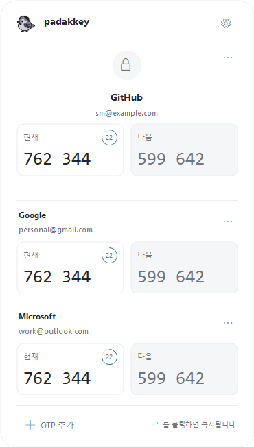

# PadakKey

참새 아이콘에서 현재·다음 인증 코드를 확인하고, 숫자를 눌러 복사하는 오프라인 TOTP 앱입니다. **macOS 13 이상**과 **Windows 11 x64**를 지원합니다.

## 다운로드

최신 공개 패키지: **Mac 0.1.24 / Windows 0.1.25** — [릴리스 안내](https://github.com/SeongMon/PadakKey/releases/tag/desktop-v0.1.25)

| 운영체제 | 다운로드 | 실행 방법 |
| --- | --- | --- |
| macOS 13+ · Apple Silicon / Intel | [Mac 다운로드](https://github.com/SeongMon/PadakKey/releases/download/desktop-v0.1.25/PadakKey-macOS-universal.zip) | 압축을 풀고 PadakKey.app을 응용 프로그램 폴더로 이동 |
| Windows 11 · x64 | [Windows 다운로드](https://github.com/SeongMon/PadakKey/releases/download/desktop-v0.1.25/PadakKey-Windows-x64.zip) | ZIP 전체를 풀고 PadakKey.exe 실행. Assets 폴더를 옆에 유지 |

공개 릴리스 파일은 GitHub 로그인 없이 다운로드할 수 있습니다. Mac과 Windows 모두 현재/다음 OTP 클릭 박스, 현재 박스 내부 원형 타이머, 회색 다음 코드를 제공합니다. 이번 릴리스는 두 운영체제 모두 첫 화면에 **시작 시 실행**(Mac: 로그인 시 실행) 스위치를 추가하고, 참새 앱 아이콘을 적용했습니다. Windows는 트레이 메뉴로 설정을 연 뒤 앱이 종료되던 문제도 수정했습니다.

이번 Mac 0.1.24 패키지는 GitHub Actions에서 빌드한 임시(ad-hoc) 서명이며 Apple 공증 전입니다. 이전 로컬 인증서 서명 빌드에서 업데이트하면 키체인 접근을 한 번 다시 허용해야 할 수 있습니다. Windows는 코드 서명 전인 미리보기입니다. OS의 게시자 확인 경고나 실행 제한이 나타날 수 있습니다.

Mac 기본 아이콘은 **24pt · 확대 100%**입니다. Windows는 OS 트레이 칸 안에서 크기와 확대율을 조절합니다.

소스 코드: [Mac](Sources/BarOTP) · [Windows](Windows) · [Windows 사용/검사 안내](Windows/README.md)


### 개발 빌드와 키체인 허용

임시(ad-hoc) 서명은 빌드마다 앱 식별 요구사항이 바뀌므로 키체인의 ‘항상 허용’이 다음 빌드에 이어지지 않을 수 있습니다. 로컬 개발 시 `bash scripts/setup-local-signing.sh`를 한 번 실행하면 로그인 키체인에 전용 서명 인증서가 생성됩니다. 이후 로컬 빌드는 같은 인증서를 자동으로 사용합니다. 인증서를 삭제하거나 매번 새로 만들지 마세요. 전환 직후에는 기존 OTP 항목에 한 번 다시 접근을 허용해야 할 수 있습니다.

이 인증서는 이 Mac의 개발용입니다. 시스템 인증서 신뢰 설정을 바꾸지 않으며 OTP 데이터도 변경하지 않습니다. 공개 배포는 동일한 Developer ID 인증서를 `SIGNING_IDENTITY`로 지정하고 공증해야 합니다. CI에서 인증서 없이 빌드한 파일은 여전히 ad-hoc 서명이므로 업데이트 때 재허용될 수 있습니다. 개인 키나 인증서 내보내기 파일을 저장소에 올리지 마세요.

### 아이콘 설정

맥·윈도우 모두 톱니바퀴의 **아이콘 선택**에서 **파닥이는 참새**, **조는 참새**를 선택할 수 있습니다. Windows는 참새 미리보기가 있는 설정 창을 제공합니다. **애니메이션**을 켰을 때만 움직이고, 끄면 즉시 기본 자세로 돌아갑니다. 선택과 ON/OFF 상태는 재실행 후에도 유지됩니다.

**아이콘 추가**로 PNG 또는 GIF를 가져오면 사용자 아이콘 목록에 추가됩니다. 파일은 Mac의 `~/Library/Application Support/PadakKey/Icons`, Windows의 `%LOCALAPPDATA%\PadakKey\Icons`에 복사됩니다. **아이콘 폴더 열기**로 직접 관리할 수도 있습니다. 정적 PNG는 항상 정지해 있고, GIF는 애니메이션 설정을 따릅니다. macOS에서는 동작 줄이기 설정이나 잠자기 중에 애니메이션이 중지됩니다.

| 아이콘 설정 | macOS | Windows |
| --- | --- | --- |
| 기본 크기 | 24pt | 트레이 칸 내부 100% |
| 크기 선택 | 16 / 20 / 22 / 24pt | 60 / 75 / 90 / 100% |
| 확대 · 여백 줄이기 | 100 / 125 / 150 / 175 / 200% | 100 / 125 / 150 / 175 / 200% |

아이콘 원본의 여백 때문에 작게 보이면 확대율을 높이세요. 높은 배율에서는 가장자리가 잘릴 수 있습니다. 크기와 확대 설정은 각각 저장됩니다.

## 기능

- 참새 아이콘을 누르면 계정별 현재 OTP와 갱신까지 남은 시간을 표시
- 현재 코드 옆에 **다음** 갱신 코드를 같은 크기의 회색 박스로 표시. 다음 코드는 다음 갱신 주기부터 사용
- 현재·다음 숫자에 같은 마우스 오버 강조 효과 적용. 별도 복사 버튼 없이 **박스 어디를 클릭해도 복사하고 창을 닫음**
- 하단에 ‘코드를 클릭하면 복사됩니다’ 안내 표시. 복사 30초 후 클립보드가 다른 내용으로 바뀌지 않았을 때만 앱이 복사한 내용을 삭제
- QR 이미지, `otpauth://totp` URI, Base32 인증 키로 계정 등록
- SHA-1 / SHA-256 / SHA-512, 6·8자리, 사용자 지정 갱신 주기
- 계정 검색, 삭제 확인, 로그인 시 자동 실행, 사용자 PNG/GIF 아이콘
- macOS 로그인 키체인 / Windows 현재 사용자 DPAPI로 계정과 인증 키 보호. 외부 서버나 자동 동기화 없음
- 한국어 UI, 시스템 라이트/다크 모드

### Windows Focus 화면



테스트 계정으로 만든 화면입니다. 실제 계정이나 인증 키는 포함하지 않습니다.

### 사용 방법

1. Mac 메뉴 막대 또는 Windows 트레이의 **참새 아이콘**을 누릅니다.
2. Mac의 **+**, Windows의 **OTP 추가**에서 서비스의 QR 이미지나 인증 키를 등록합니다.
3. **현재 코드 박스**를 클릭해 복사합니다. 회색 **다음 코드 박스**를 클릭하면 다음 주기의 코드를 복사합니다.
4. 복사가 성공하면 상태창이 닫힙니다. 다시 확인하려면 참새 아이콘을 누릅니다.

| 플랫폼별 항목 | macOS | Windows |
| --- | --- | --- |
| QR 이미지 | PNG / JPEG / TIFF / HEIC | PNG / JPEG / BMP / GIF |
| 계정 보호 | 로컬 로그인 키체인 | 현재 Windows 사용자에 묶인 DPAPI |
| 검색 | 서비스 또는 계정 검색 | 4개 이상이면 검색 표시, Ctrl+F로 열기 |
| 계정 삭제 | 각 계정의 휴지통 | 각 계정의 `…` → 계정 삭제 |

Google/Microsoft Authenticator와 **동일한 표준 TOTP 키**를 등록할 수 있습니다. 기존 앱의 계정에 자동 접근하거나 동기화하지 않습니다. Microsoft 푸시 승인, HOTP, Steam 특수 코드 및 Google Authenticator 일괄 이전(`otpauth-migration`) QR은 지원하지 않습니다.

## 최근 변경

### 0.1.19

- 맥·윈도우 현재·다음 코드의 마우스 오버 효과 통일
- 별도 복사 버튼과 아이콘 제거, 하단 클릭 복사 안내 추가
- 숫자 클릭 복사와 복사 후 상태창 닫기 유지

### 0.1.18

- 맥·윈도우에 다음 갱신 코드 표시와 클릭 복사 추가
- 6·8자리, 각 계정의 갱신 주기와 알고리즘에 맞춰 다음 코드 계산
- 갱신 경계에서 다음 코드를 복사할 때 이전 주기의 미리보기를 복사하지 않도록 처리

### Windows 0.1.16–0.1.17

- Focus 상태창, 라이트·다크 화면, 참새 미리보기 설정 창 적용
- 사용자 아이콘, 크기·확대, Windows 시작 시 실행 설정 제공
- 복사 성공 시 창 닫기와 검색 시 트레이 기준 창 위치 유지

<details>
<summary>이전 변경 사항 · 0.1.8 이하</summary>

## 0.1.8 수정

- 앱 이름을 파닥키(PadakKey)로 바꾸고 귀 움직임 간격을 8초에서 약 5초로 줄였습니다.
- 기존 계정을 유지하기 위해 bundle ID와 키체인 서비스 식별자는 유지합니다. Swift 패키지 이름은 BarOTP를 유지하며, GitHub 저장소는 PadakKey입니다.

## 0.1.7 수정

- macOS ‘동작 줄이기’ 설정 및 잠자기에서는 애니메이션을 멈춥니다.

## 0.1.6 수정

- 계정 수에 맞춰 팝오버와 SwiftUI 화면 높이를 함께 조정합니다. 한 계정은 280pt, 두 계정은 392pt이며 세 계정 이후에는 목록만 스크롤합니다.
- 검색 결과가 줄어들면 창도 작아지며, 결과가 없으면 안내를 표시합니다.

## 0.1.5 수정

- 로딩 화면과 OTP 목록에 동일한 팝오버 높이를 적용해 비동기 조회 후 코드 영역이 잘리는 문제를 수정했습니다.
- 상단·하단 영역은 고정하고 계정 목록만 스크롤합니다.

## 0.1.4 수정

- 자동 조회는 암호창을 띄우지 않으며, 접근 승인이 필요할 때만 ‘접근 허용’을 표시합니다.
- 접근 취소·거절은 빨간 오류 대신 권한 안내로 표시하고, 인증 요청 중복 및 닫힌 화면으로의 늦은 응답을 차단합니다.
- 키체인 읽기는 백그라운드에서 수행합니다. 저장된 키의 접근 제어는 변경하지 않습니다.
- ad-hoc 빌드의 업데이트 후 재승인은 macOS가 요구할 수 있습니다. 이를 없애려면 일관된 정식 서명으로 배포해야 합니다.
- `bash scripts/verify-vault.sh`는 실제 사용자 키체인에 접근하지 않고 상태 전환을 검증합니다.

## 0.1.3 수정

- 메뉴 막대 클릭마다 저장된 계정을 자동으로 불러와 OTP 목록을 즉시 표시합니다. 별도 ‘인증 코드 열기’ 단계가 없습니다.
- 팝오버 닫기·다시 열기를 AppKit 생명주기로 처리하고 검색 상태를 초기화합니다.

## 0.1.2 수정

- 메뉴 막대 아이콘과 등록 창을 앱 수명 동안 유지하는 AppKit 구조로 변경했습니다.
- 이미지 선택창의 부모를 등록 창으로 고정하고 선택창 인스턴스를 명시적으로 유지합니다.
- QR 인식을 백그라운드에서 수행해 UI가 응답하도록 했습니다.
- 같은 앱의 중복 실행을 차단합니다.

## 0.1.1 수정

- 계정 추가를 독립 창으로 분리해 파일 선택 시 메뉴 팝오버가 닫혀도 입력 상태를 유지합니다.
- QR 인식 성공 시 계정 이름과 저장 안내를 표시합니다.
- 이미지 열기 실패, QR 없음, 잘못된 QR, Google 일괄 이전 QR을 구분해 안내합니다.
- `bash scripts/verify-qr.sh`로 실제 PNG/JPEG/TIFF QR 디코딩과 오류 처리를 검증합니다.

</details>

## 소스에서 실행

### macOS

```sh
bash scripts/build.sh
open dist/PadakKey.app
```

`dist/PadakKey.app`을 응용 프로그램 폴더에 복사하세요. Dock 아이콘이나 기본 창 없이 상단 메뉴 막대에 참새 아이콘이 나타납니다. 앱 메뉴의 톱니바퀴에서 종료할 수 있습니다.

사이트의 보안 → 2단계 인증 → 인증 앱 등록 화면에서 QR 이미지를 저장하거나 수동 키를 복사합니다. PadakKey의 **+**에서 등록한 뒤, 생성된 코드를 사이트에 입력해 설정을 마무리하세요. 이미 등록된 서비스에서 키를 다시 보여주지 않으면 해당 서비스의 재설정 절차가 필요합니다. 복구 코드는 별도로 보관하세요. QR 이미지에도 비밀 키가 포함되므로 공유하거나 저장소에 커밋하지 마세요.

### Windows

Windows와 .NET 10 SDK가 필요합니다. 소스에서 실행하려면 저장소 루트에서 다음 명령을 사용하세요.

```powershell
dotnet run --project Windows/PadakKey -c Release
```

배포용 실행 파일 생성, 검사, 데이터 위치는 [Windows 안내](Windows/README.md)를 참고하세요. ZIP 배포본에는 .NET 런타임이 포함되므로 SDK를 따로 설치하지 않아도 됩니다.

## 개발 / 검증

Mac 개발에는 Swift 5.9 이상 및 macOS SDK가 필요합니다. Swift Package이므로 Xcode 프로젝트 파일 없이 빌드할 수 있습니다. Windows 개발 명령은 [Windows 안내](Windows/README.md#개발--검사)에 정리되어 있습니다.

```sh
swift test
swift run BarOTP
ARCH=native bash scripts/build.sh  # 개발 중 현재 아키텍처만 빌드
```

Command Line Tools만 설치되어 XCTest가 없으면 `bash scripts/verify-core.sh`로 동일한 코어 검증 케이스를 실행할 수 있습니다.

테스트는 RFC 6238의 SHA-1/256/512 전체 18개 벡터, 6·8자리 현재·다음 코드, 사용자 지정 갱신 주기와 시간 경계, Base32 검증, URI 오류 처리를 확인합니다. Windows 검사는 DPAPI 저장·복원, QR 이미지 해독, Focus 화면과 현재·다음 코드 클릭 후 닫기까지 확인합니다.

수동 검증: 앱 실행 → 테스트용 계정 등록 → 다른 표준 인증기와 코드 비교 → 복사 → 다른 내용을 복사하면 덮어쓰지 않는지 확인 → 앱 재실행 후 계정 유지 확인 → 삭제 → 잠자기/잠금 및 자동 실행 확인. 실제 인증 키를 테스트 코드에 넣지 마세요.

## GitHub 배포

`main` push 및 PR에서 맥·윈도우 검사와 빌드가 실행됩니다. 성공한 실행의 **Artifacts**에서 설치 파일을 받을 수 있으며, 보관 기간은 30일입니다.

| 빌드 | 산출물 이름 | 포함 파일 |
| --- | --- | --- |
| [macOS Universal](https://github.com/SeongMon/PadakKey/actions/workflows/ci.yml) | `PadakKey-macOS-universal` | 앱 ZIP과 SHA-256 체크섬 |
| [Windows x64](https://github.com/SeongMon/PadakKey/actions/workflows/windows.yml) | `PadakKey-Windows-x64` | `PadakKey.exe`, `Assets/` |

`v0.1.19` 같은 버전 태그를 push하면 현재 Release 워크플로가 **macOS ZIP과 SHA-256 체크섬이 첨부된 초안 Release**를 만듭니다. Windows 산출물은 별도 Windows 빌드에서 받습니다. `main`에 커밋하는 것만으로 공개 Release가 게시되지는 않습니다.

기본 CI 산출물은 ad-hoc 서명이며 Apple Developer ID 서명·공증이 없습니다. 다운로드한 앱은 Gatekeeper가 차단할 수 있습니다. 출처와 체크섬을 확인한 사용자만 시스템 설정 → 개인정보 보호 및 보안에서 macOS가 제공하는 열기 절차를 이용하세요. Gatekeeper 전체를 비활성화하지 마세요.

일반 사용자 배포에는 Apple Developer ID 인증서와 공증을 권장합니다. 인증서를 로컬 키체인에 설치하고 `xcrun notarytool store-credentials`로 공증 프로필을 만든 뒤:

```sh
VERSION=0.1.19 SIGNING_IDENTITY='Developer ID Application: YOUR NAME (TEAMID)' NOTARY_PROFILE='barotp-notary' bash scripts/build.sh
```

이 명령은 hardened runtime 서명 → 공증 → staple → ZIP 재생성까지 수행합니다. 생성된 ZIP/체크섬으로 초안 Release의 파일을 교체하고 게시하세요. 인증서·암호·API 키는 저장소에 올리지 마세요. CI 서명 자동화는 조직의 GitHub Secrets와 인증서 정책에 맞춰 별도로 연결해야 합니다.

## 보안과 제한

- macOS: 비밀 키와 계정 메타데이터는 Security.framework의 로컬 로그인 키체인 항목 하나에 JSON으로 저장합니다. 평문 설정 파일·UserDefaults에는 저장하지 않습니다. iCloud 동기화를 요청하지 않습니다.
- Windows: `%LOCALAPPDATA%\PadakKey\accounts.dpapi`에 현재 사용자 DPAPI로 암호화해 저장합니다. 다른 사용자나 PC로 파일만 복사해 복구할 수 없습니다. 프로그램 업데이트 시 이 계정 파일을 덮어쓰지 마세요.
- macOS에서는 팝오버가 닫히거나 세션 비활성화·잠자기·화면 잠금 알림이 오면 메모리의 계정 목록을 비웁니다. Swift 문자열의 메모리 완전 소거를 보장하지 않습니다. Windows에서는 상태창을 닫거나 화면을 잠그면 표시 중인 계정 목록을 비웁니다.
- 앱 자체의 Touch ID 잠금은 없습니다. 로그인된 Mac에 접근 가능한 사용자는 코드를 볼 수 있습니다. 로컬 로그인 키체인의 보호 및 접근 제어에 의존합니다.
- 클립보드 관리자에는 비밀/임시 콘텐츠 힌트를 제공하지만 모든 앱이 이를 준수하지는 않습니다. 앱이 강제 종료되면 30초 뒤 삭제가 실행되지 않을 수 있습니다.
- ad-hoc 재빌드나 서명 변경 시 키체인이 접근 승인을 다시 요구할 수 있습니다. 정식 배포에서는 bundle ID와 Developer ID를 유지하세요.
- 자동 동기화·키 내보내기·백업·자동 업데이트는 없습니다. 앱 삭제만으로 키체인의 계정이 삭제되지는 않습니다. 계정 제거는 앱에서 진행하세요.
- PC의 날짜/시간이 틀리면 코드가 맞지 않을 수 있습니다.

참고: [RFC 6238](https://www.rfc-editor.org/rfc/rfc6238), [Apple Keychain services](https://developer.apple.com/documentation/security/keychain-services).
