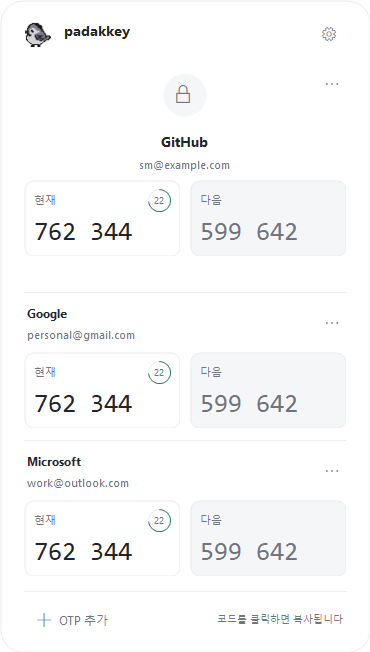

# PadakKey for Windows (preview)

Windows 11 x64용 트레이 앱입니다. Windows 10은 현재 실제 기기 검증 대상에 포함되지 않습니다.

## 실행

[Windows 0.1.23 다운로드](https://github.com/SeongMon/PadakKey/releases/download/desktop-v0.1.23/PadakKey-Windows-x64.zip)를 다운로드하고 ZIP 전체를 폴더에 풀어 `PadakKey.exe`를 실행하세요. .NET 런타임은 포함됩니다. 최상단에는 `PadakKey.exe`와 `Assets` 폴더만 있습니다. DLL과 .NET 런타임은 실행 파일에 묶었습니다. `Assets` 폴더는 실행 파일 옆에 유지하세요. 코드 서명되지 않은 개발 빌드로 Windows가 게시자 확인 경고를 표시할 수 있습니다.

공개 릴리스에서 GitHub 로그인 없이 다운로드할 수 있습니다. [릴리스 안내](https://github.com/SeongMon/PadakKey/releases/tag/desktop-v0.1.23)에서 운영체제별 실제 버전과 변경사항을 확인하세요.

업데이트할 때는 실행 중인 PadakKey를 종료하고 새 ZIP 전체를 풀어 실행하세요. 계정과 설정은 프로그램 폴더와 별개인 `%LOCALAPPDATA%\PadakKey`에 저장되므로 이 데이터 폴더를 덮어쓰거나 삭제하지 마세요.

## 코드 확인과 복사

오른쪽 아래 `^`에서 참새 아이콘을 클릭하면 Focus 상태창이 열립니다. 아이콘을 항상 표시할지는 Windows 설정에서 결정합니다. 첫 번째 OTP를 크게 보여 주고, 나머지 계정은 간결한 목록에 표시합니다.

1. **OTP 추가**에서 QR 이미지 또는 수동 Base32 키 / `otpauth` URI로 계정을 등록합니다. QR 이미지는 백그라운드에서 읽고 저장 전에 서비스·계정을 확인할 수 있습니다.
2. **현재 코드 박스**를 클릭하면 현재 코드를 복사합니다.
3. 회색 **다음 코드 박스**를 클릭하면 다음 갱신 주기의 코드를 복사합니다. 다음 코드는 다음 갱신 주기부터 사용할 수 있습니다.

두 숫자에 마우스를 올리면 같은 강조 효과가 표시됩니다. 별도 복사 버튼 없이 하단에 ‘코드를 클릭하면 복사됩니다’ 안내를 표시하며, 어느 쪽이든 복사 성공 직후 상태창이 닫힙니다. 바깥 클릭이나 Esc로도 닫습니다. 복사 30초 후 클립보드 내용이 다른 앱에 의해 바뀌지 않았을 때만 지웁니다.



테스트 계정으로 만든 화면입니다. 실제 계정이나 인증 키는 포함하지 않습니다.

## 설정과 데이터

- 톱니바퀴: 참새 미리보기가 있는 설정 창. 파닥이는 참새 / 조는 참새, 애니메이션 ON/OFF, 아이콘 크기 60~100%, 확대 100~200%, 사용자 PNG/GIF 추가·선택, 아이콘 폴더 열기
- 설정의 **Windows 시작 시 실행**: 현재 사용자 로그인 시 실행. 기본값은 꺼짐이며 사용자가 켰을 때만 등록합니다.
- 시스템 라이트/다크 색상을 실행 시 반영합니다. 4개 이상 계정은 검색과 목록 스크롤을 제공하며, Ctrl+F로 검색을 열 수도 있습니다. 각 계정의 `…` 메뉴에서 삭제할 수 있습니다.
- Windows 트레이 칸의 크기 자체는 OS가 정합니다. 100%가 칸 내부 최대 크기입니다.
- 설정과 아이콘: `%LOCALAPPDATA%\PadakKey`
- 계정: 같은 위치의 `accounts.dpapi`, 현재 Windows 사용자에 묶인 DPAPI 암호화. 원본 키를 평문 파일로 저장하지 않습니다.
- Mac 계정을 자동으로 동기화하거나 가져오지는 않습니다. 각 서비스에서 등록 키를 따로 추가해야 합니다. Windows 사용자/PC 변경 시 파일만 복사하는 방식으로 복구할 수 없습니다.
- HOTP와 Google Authenticator 일괄 이전 QR은 지원하지 않습니다.

## 개발 / 검사

.NET 10 SDK와 Windows가 필요합니다.

```
dotnet run --project Windows/PadakKey.Checks -c Release
dotnet build Windows/PadakKey -c Release
Windows\PadakKey\bin\Release\net10.0-windows\PadakKey.exe --self-test
dotnet publish Windows/PadakKey -c Release -r win-x64 --self-contained true -p:PublishSingleFile=true -p:IncludeNativeLibrariesForSelfExtract=true -p:DebugType=None -p:DebugSymbols=false -o artifacts/PadakKey-Windows-x64
Windows\PadakKey\bin\Release\net10.0-windows\PadakKey.exe --ui-preview artifacts/focus-preview
```

CI는 RFC6238의 SHA1/256/512 벡터, 6·8자리 현재·다음 코드와 갱신 경계, 입력 검증, DPAPI 저장/복원 및 손상 파일 거부, 생성한 QR의 이미지 해독, 아이콘 로딩과 Focus 화면 검사를 실행합니다. 화면 검사는 임시 저장소의 테스트 계정으로 라이트/다크, 빈 목록, 다중 계정, 기본/사용자 아이콘 설정, 등록 창, 코드 갱신, 현재·다음 코드 클릭 후 창 닫기를 검사합니다. `--ui-preview`는 같은 테스트 화면을 PNG로 저장합니다. 실제 OTP 데이터와 사용자 아이콘 목록은 테스트에 사용하지 않으며, 자동 실행 설정을 변경하지 않습니다.

## 실제 Windows에서 확인할 항목

- 트레이 숨김 영역과 항상 표시 상태에서 열기, 바깥 클릭 및 복사 후 닫기
- 100/150/200% 배율, 다중 모니터, 화면 가장자리의 창 위치
- 두 애니메이션의 ON/OFF, 크기 조절, 사용자 PNG/GIF, 재실행 후 설정 유지
- 서비스의 OTP로 실제 로그인, PC 시간 자동 동기화
- QR 이미지 선택 취소/실패, 계정 추가·삭제, 손상 파일 복구 안내
- 잠금/해제, 클립보드 변경 및 30초 자동 삭제, 종료·중복 실행

다중 모니터와 100/150/200% 실제 화면 배율은 위 수동 검사 대상입니다. ARM64 패키지는 포함하지 않습니다.
